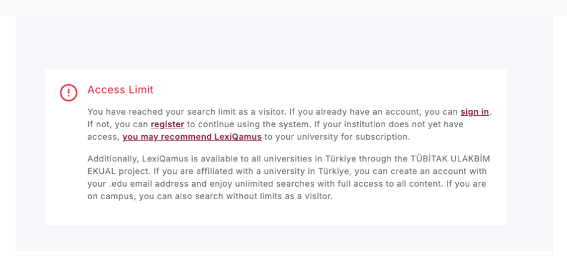
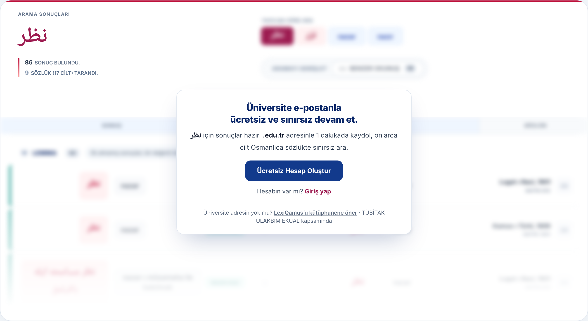
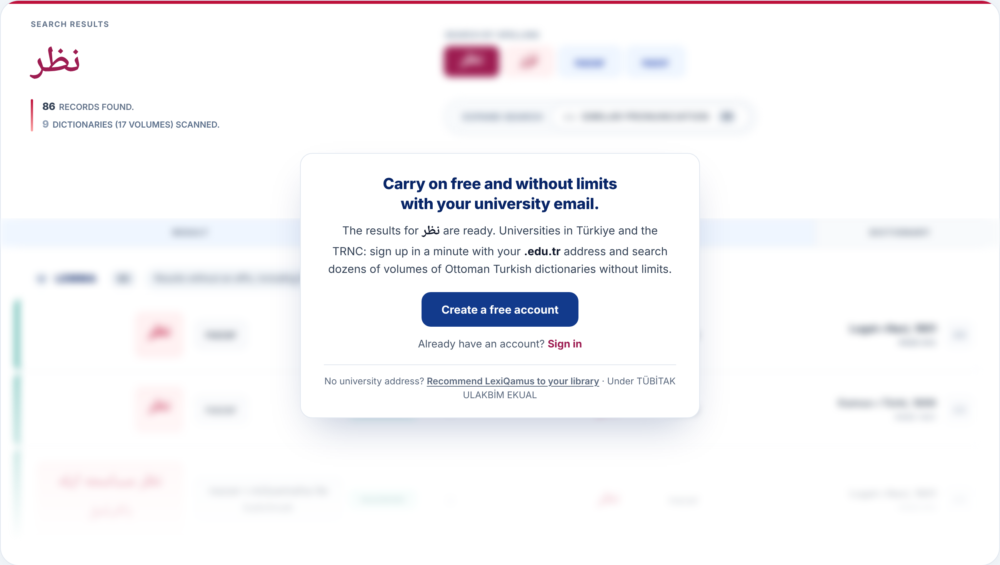
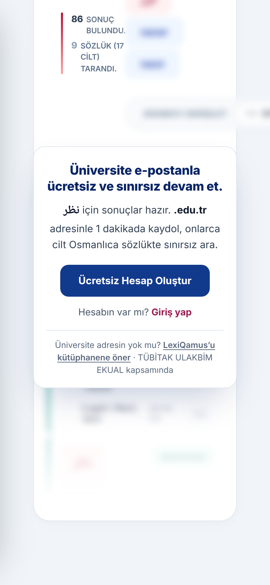

# LQ-CV-1 — The access-limit screen leads with the free account

- **Area:** Search page — what a visitor sees when their free searches are used up
- **Type:** Change to an existing screen (wording, layout and one new field from the server)
- **Front end:** done in the new front end (`muhammethabib/lq-frontend`, commits `850b9c6` and `4f4807e`)
- **Server:** one new field on the search response, and a decision on what results are sent while it is set (see *What the server needs to do*)

---

## Summary

When a visitor has used up their free searches, the site today shows an
*Access Limit* warning. It is the moment the visitor wants the site most —
they have just searched for a word — but the first thing they read is a
warning, followed by a paragraph about subscriptions.

The new screen keeps the visitor's results on the page, blurred, and puts a
short offer over them: carry on free with a university email address. One
button opens the sign-up window.

## Today



## New

**Desktop, Turkish**



**Desktop, English**



**Phone (390 px wide), Turkish**



## How it behaves

1. The visitor searches for a word after their free searches are used up.
2. The results page opens as usual. The term, the record count and the
   dictionary count are shown normally at the top.
3. The spelling and *Expand search* controls, and the list of results, are
   shown **blurred** and fade out towards the bottom. They cannot be clicked,
   reached with the keyboard or read by a screen reader. The *Scan for
   Similar Matches* bar and the jump bar are hidden.
4. A card sits over the top of the list, with:
   - the title;
   - one line that says the results for **the word they searched** are ready,
     and how to get them;
   - the **Create a free account** button — it opens the existing sign-up
     window;
   - *Already have an account? Sign in* — it opens the existing sign-in
     window;
   - a small footer line: *No university address? Recommend LexiQamus to your
     library* (a link), and the TÜBİTAK ULAKBİM EKUAL credit.
5. The searched word appears inside the line. English puts it before the
   words and Turkish after them, so the line has a slot on each side (the
   same way the *No results* line already works).

## New text

Copy these exactly. Bold parts are marked with `<b>…</b>`.

| Part | English | Turkish |
|------|----------|----------|
| Title | `Carry on free and without limits with your university email.` | `Üniversite e-postanla ücretsiz ve sınırsız devam et.` |
| Before the word | `The results for` | *(empty)* |
| After the word | `are ready.` | `için sonuçlar hazır.` |
| How to get them | `Universities in Türkiye and the TRNC: sign up in a minute with your <b>.edu.tr</b> address and search dozens of volumes of Ottoman Turkish dictionaries without limits.` | `<b>.edu.tr</b> adresinle 1 dakikada kaydol, onlarca cilt Osmanlıca sözlükte sınırsız ara.` |
| Button | `Create a free account` | `Ücretsiz Hesap Oluştur` |
| Sign-in line | `Already have an account?` | `Hesabın var mı?` |
| Sign-in link | `Sign in` | `Giriş yap` |
| Footer, question | `No university address?` | `Üniversite adresin yok mu?` |
| Footer, link | `Recommend LexiQamus to your library` | `LexiQamus’u kütüphanene öner` |
| Footer, credit | `Under TÜBİTAK ULAKBİM EKUAL` | `TÜBİTAK ULAKBİM EKUAL kapsamında` |

The English line says who the offer is for (*Universities in Türkiye and the
TRNC*), because most English readers are outside Türkiye. The Turkish line
does not need it.

## What the server needs to do

1. **Tell the page the visitor is over the limit.** The search response gets
   one new field:

   ```json
   { "accessLimited": true, "...": "the usual result fields" }
   ```

   When it is `true`, the page shows this screen. When it is missing or
   `false`, the page shows the results as usual.

2. **Decide what results to send while it is set.** The page blurs whatever
   it is sent, but blurring is only a look: anything in the response can
   still be read in the browser's developer tools. So while `accessLimited`
   is `true`, please **do not send the full result set.** Send only what is
   needed for the blurred list to look real — for example the first few
   rows, or rows without the meaning text. The term and the counts at the
   top can be the real ones.

3. **Never set it for campus users or logged-in members.** A visitor on a
   university network has unlimited access, so they should never get
   `accessLimited`.

## In the new front end

| What | Where |
|----|------------|
| Markup | `pages/home.html` — the `access-limit` block inside the results section |
| Behaviour | `js/controllers/home_controller.js` — `limitAccess()`, called from `receive()` with `results.accessLimited` |
| Look | `css/home.css` — the *access limit* section |
| Turkish text | `js/translations.js` — the `limit…` keys |
| To see it | the view switcher on the main page → **Access Limit**, or open `pages/home.html?state=access-limit` |

## Still to decide

- **Where *Recommend LexiQamus to your library* goes.** The link has no
  target yet (`#`). The *Does My Library Subscribe?* button on the main page
  has no target either; the two should probably lead to the same place.
- **"in a minute" / "1 dakikada".** This is only true if sign-up, including
  the e-mail confirmation, really takes about a minute. If it does not, the
  words should change.

## Done when

- [ ] A visitor over the limit sees the new screen, with the word they
      searched in the line.
- [ ] The list behind the card is blurred, cannot be clicked or tabbed into,
      and the server does not send the full results while the limit applies.
- [ ] *Create a free account* opens the sign-up window; *Sign in* opens the
      sign-in window.
- [ ] Turkish and English text match the table above.
- [ ] The screen works on a phone.
- [ ] Logged-in users and campus users never see it.
