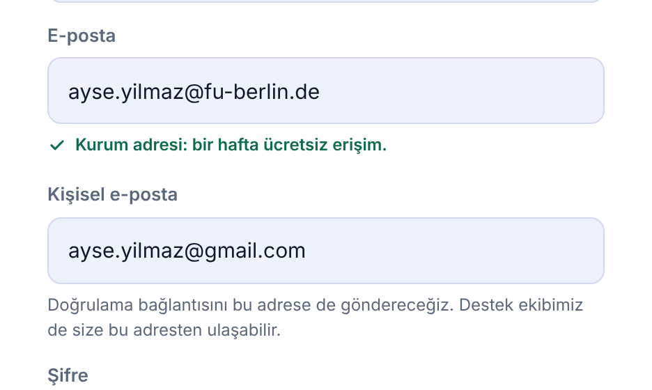
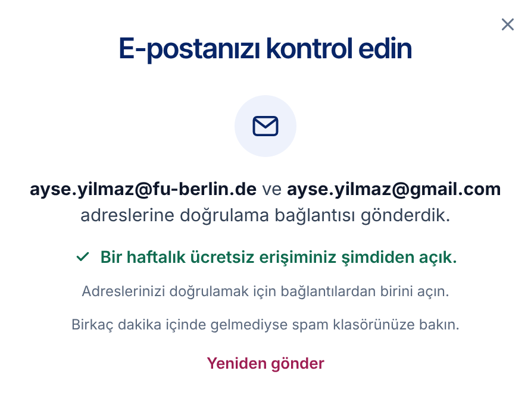

# LQ-CV-2 — Sign-up with an institutional address: access by domain, two addresses, one account

- **Area:** The sign-up window, two new steps shown after it, and the access an account gets at sign-up
- **Type:** Change to the form, two new steps, and new account and access rules on the server
- **Front end:** done in the new front end (`muhammethabib/lq-frontend`, commits `850b9c6`, `901fded`, `99858fd`, `6816be7` and `cd8516b`)
- **Server:** the access decision at sign-up, a second address on the account, a confirmation link to each address, address checks, and a review list for support (see *Access decision at sign-up* and *What the server needs to do*)
- **Attached:** `Academic_Domains_Auto_Access.xlsx` — the *Approved Domains* list and the *Rules* sheet

---

## Summary

People with an institutional email address get free access: institutions in
Türkiye for life, institutions abroad for one week. Today the sign-up form
never says so, and when the confirmation email does not reach an
institutional address — which happens: institutional mail systems block or
delay it — the person is stuck and drops out.

The new flow:

1. **Access is decided at sign-up, from the domain of the email alone,** by
   the rules below. It does not wait for the confirmation email, and no one
   has to approve it.
2. **The form says what the address will get** as soon as it is typed: free
   with no time limit, or free for one week.
3. **An institutional address also asks for a personal address.** Both are
   checked for typos before the form can go on.
4. **The addresses are shown large** before the account is made, with the
   question *Are you sure there is no typo?* — a mistyped address is one the
   link never reaches.
5. **A confirmation link goes to each address.** There is one account. The
   links confirm the addresses; the access is already open.
6. **Support follows up** on accounts whose institutional address was never
   confirmed: writes to the person, asks for institution, programme and year,
   and blocks the account if the address turns out to be made up.
7. **The newsletter box starts unticked.** Today it is ticked in advance.
   Under KVKK and the GDPR, consent to marketing mail has to be given by the
   user; a box that is already ticked does not count as consent.

## Decisions already taken

- **Access is granted immediately at account creation,** from the domain of
  the email alone. No manual approval, and no waiting for the confirmation
  link.
- **One account, two addresses.** The institutional address is the main
  one; the personal address is the second one.
- **A separate confirmation link to each address,** sent at the same time.
  Clicking a link confirms that address.
- **Typos are caught on the form.** An address that is not an email address,
  or that has a common typo (`gamil` for `gmail`), does not create an account.
- **Suspicious accounts are reviewed by hand afterwards.** Support writes to
  the person and blocks the account if the institutional address is made up.
  Such cases are few.

## Access decision at sign-up

Access is decided from the **domain** of the email — the part after `@`, in
lower case. **Apply the rules in order; the first one that matches
decides.**

| # | Rule | Pattern | Access | Examples |
|-|-----------|--------|-------|-----------|
| 1 | The domain is on the **Approved Domains** list, or is a subdomain of a listed domain | the listed domain, or anything ending in `.` + the listed domain | As listed: Türkiye = Lifetime, abroad = 1 week | `sabanciuniv.edu`, `su.sabanciuniv.edu`, `bilgiedu.net`, `tubitak.gov.tr`, `tuba.gov.tr`, `fu-berlin.de` |
| 2 | Ends with `.edu.tr` | `\.edu\.tr$` | **Lifetime** | `boun.edu.tr`, `bilgi.edu.tr`, `stu.omu.edu.tr` |
| 3 | Contains `alumni` | `alumni` | **1 week** | `stanfordalumni.org`, `alumni.harvard.edu` |
| 4 | Ends with `.edu` | `\.edu$` | **1 week** | `uchicago.edu`, `yale.edu` |
| 5 | Ends with `.ac.uk` | `\.ac\.uk$` | **1 week** | `cam.ac.uk`, `dmu.ac.uk` |
| 6 | Ends with `.edu.XX` (two-letter country code) | `\.edu\.[a-z]{2}$` | **1 week** | `nu.edu.kz`, `fudan.edu.cn` |
| 7 | Ends with `.ac.XX` (two-letter country code) | `\.ac\.[a-z]{2}$` | **1 week** | `univie.ac.at`, `tufs.ac.jp` |
| 8 | Anything else | `.*` | **No access** (standard account) | `gmail.com`, company domains, `robcol.k12.tr`, `adalet.gov.tr` |

- **Rule 1** covers institutions whose domain does not follow the patterns:
  Sabancı (`sabanciuniv.edu`, which also covers `su.sabanciuniv.edu`), Bilgi
  students (`bilgiedu.net`), the ULAKBİM consortium `.gov.tr` members
  (`tubitak.gov.tr`, `tuba.gov.tr` and others), and universities abroad on
  plain national domains (`fu-berlin.de`, `uu.nl` and others). The full list
  is on the **Approved Domains** sheet of the attached file.
- **Rule 2** covers universities in Türkiye and the TRNC, including student
  and alumni subdomains (`ogr.`, `stu.`, `std.`, `alumni.`).
- **Rule order matters.** Rule 1 must catch Sabancı before rule 4 can give it
  only one week.
- **Several addresses:** apply the rules to every address of the user; the
  best result wins: **Lifetime > 1 week > No access.** With a personal
  address (no access) and an institutional one, the institutional result
  decides.
- **New exceptions are added only to the Approved Domains list.** No code
  change should be needed.
- **Access does not wait for email confirmation.** It is granted at sign-up
  from the domain alone; suspicious accounts are reviewed by hand afterwards.
- **One week** runs from the moment the account is made. After that the
  account is a standard account.

## Today

The newsletter box is already ticked, nothing mentions institutional access,
there is no second address and no check before the account is made.

## New

### 1. The form

The line under *Email* is new; the newsletter box is unticked.

### 2. Address checks

**Not an email address** — refused, with an example:

**A likely typo** — the corrected address is offered back; one press puts it
in the field. The form does not go on until the address is fixed:

### 3. An institutional address is typed

The line says what the address gets, and the *Personal email* field opens
below it. It is required.

**Lifetime** (here a `.edu.tr` address):

**One week** (here `fu-berlin.de`, from the Approved Domains list):

The personal email cannot be another institutional address:

### 4. After *Create account*: the addresses, large

**Institutional sign-up** — both addresses, labelled:

**Personal-address sign-up** — the one address:

### 5. After *Yes, create my account*: check your inbox

**Institutional sign-up, lifetime** — a link went to each address, and the
free access is already open:

**Institutional sign-up, one week:**

**Personal-address sign-up:**

## How it behaves

1. When the form opens, the line under *Email* shows the offer. The
   *Personal email* field is not shown.
2. As the person types, the page works out what the address will get, by the
   rules above, after every key press:
   - **Lifetime** → *Institutional address: free access with no time limit.*
   - **1 week** → *Institutional address: free access for one week.*
   - **No access** → the offer stays.

   For Lifetime and 1 week, the *Personal email* field appears and becomes
   required. If the address is changed to one with no access, the field goes
   away again.
3. **Each address is checked when the person leaves the field, and again on
   *Create account*:**
   - no `@`, or no proper domain → *Enter a valid email address, such as
     name@gmail.com.*
   - a likely typo → *Did you mean …?* with the corrected address as a button;
   - the personal email empty → *Please add a personal email as well.*
   - the personal email is also an institutional address (Lifetime or 1 week
     by the rules) → *Use an address outside your institution, such as Gmail
     or Outlook.*

   While any of these is showing, *Create account* does not go on, and the
   cursor goes to that field.
4. **The typo check** catches:
   - a domain one or two letters away from a common provider: `gmail.com`,
     `hotmail.com`, `outlook.com`, `yahoo.com`, `icloud.com`, `yandex.com`,
     `live.com`, `hotmail.com.tr`, `outlook.com.tr`, `yandex.com.tr`
     (so `gamil.com`, `gmial.com`, `gmail.con`, `hotmial.com`, `outlok.com`);
   - a broken `.edu.tr` ending: `edutr`, `edu.rt`, `.edu.t`, `.edu.trr`,
     `.eud.tr`, `.ude.tr` → `.edu.tr`.

   It never "corrects" an institutional domain, nor real domains that sit
   close to a common provider: `mail.com`, `email.com`, `ymail.com`,
   `gmx.com`, `gmx.de`, `gmx.net`, `me.com`, `mac.com`, `aol.com`, `msn.com`,
   `proton.me`, `protonmail.com`, `yandex.ru`, `mail.ru`, `ttmail.com`.
5. **Create account** shows the addresses large, with *Are you sure there is
   no typo? Otherwise the confirmation link will not reach you.*
   - *Yes, create my account* creates the account and goes to the inbox step.
   - *Fix it* goes back to the form, with everything still filled in.
6. **The inbox step** names the address (or both addresses) the links went
   to. For an institutional address it says the free access is already open
   (with no time limit, or for a week) and that the links confirm the
   addresses. It offers *Send it again*.
7. The newsletter box is unticked when the form opens.
8. Screen readers hear the changing lines (the hint, the errors and the
   suggestion are polite live regions).

In the front end, the Approved Domains list is a copy of the spreadsheet in
`js/academic_domains.js`, so the form can show the right line while the
address is typed. At integration the page should get the answer from the
server instead (see item 4 under *What the server needs to do*), so the
list lives in one place.

## New text

Copy these exactly. Bold parts are marked with `<b>…</b>`. The Turkish text
addresses the reader as *siz*, as the rest of the site does.

**The form**

| Part | English | Turkish |
|------|----------|----------|
| Offer (before an institutional address is typed) | `Universities in Türkiye and the TRNC: sign up with your <b>.edu.tr</b> address to use LexiQamus free and without limits.` | `<b>.edu.tr</b> adresinizle kaydolun, LexiQamus’u ücretsiz ve sınırsız kullanın.` |
| Lifetime address | `Institutional address: free access with no time limit.` | `Kurum adresi: ücretsiz ve süresiz erişim.` |
| One-week address | `Institutional address: free access for one week.` | `Kurum adresi: bir hafta ücretsiz erişim.` |
| Personal email, label | `Personal email` | `Kişisel e-posta` |
| Personal email, hint | `We will send a confirmation link here too. Our support team can also reach you here.` | `Doğrulama bağlantısını bu adrese de göndereceğiz. Destek ekibimiz de size bu adresten ulaşabilir.` |
| Error, not an email address | `Enter a valid email address, such as name@gmail.com.` | `Geçerli bir e-posta adresi yazın; örneğin ad@gmail.com.` |
| Error, personal email empty | `Please add a personal email as well.` | `Kişisel e-posta adresinizi de yazın.` |
| Error, personal email is institutional | `Use an address outside your institution, such as Gmail or Outlook.` | `Kurumunuz dışında bir adres yazın; örneğin Gmail ya da Outlook.` |
| Typo, before the address | `Did you mean` | `Bunu mu demek istediniz:` |
| Typo, after the address | `?` | `?` |

**Before the account is made**

| Part | English | Turkish |
|------|----------|----------|
| Title, one address | `Check your email address` | `E-posta adresinizi kontrol edin` |
| Title, two addresses | `Check your email addresses` | `E-posta adreslerinizi kontrol edin` |
| Label, institutional address | `Institutional email` | `Kurum e-postası` |
| Label, personal address | `Personal email` | `Kişisel e-posta` |
| Question | `Are you sure there is no typo?` | `Yazım hatası olmadığına emin misiniz?` |
| Why | `Otherwise the confirmation link will not reach you.` | `Aksi halde doğrulama bağlantısı size ulaşmaz.` |
| Main button | `Yes, create my account` | `Evet, hesabımı oluştur` |
| Second button | `Fix it` | `Düzelt` |

**The inbox step**

| Part | English | Turkish |
|------|----------|----------|
| Title | `Check your inbox` | `E-postanızı kontrol edin` |
| One address — before it | `We sent a confirmation link to` | *(empty)* |
| One address — after it | `.` | ` adresine doğrulama bağlantısı gönderdik.` *(starts with a space)* |
| Two addresses — before them | `We sent a confirmation link to` | *(empty)* |
| Two addresses — between them | `and to` | `ve` |
| Two addresses — after them | `.` | ` adreslerine doğrulama bağlantısı gönderdik.` *(starts with a space)* |
| Access, lifetime | `Your free access is already open, with no time limit.` | `Ücretsiz ve süresiz erişiminiz şimdiden açık.` |
| Access, one week | `Your free week of access is already open.` | `Bir haftalık ücretsiz erişiminiz şimdiden açık.` |
| Next line, one address | `Open it to finish creating your account.` | `Hesabınızı oluşturmayı tamamlamak için bağlantıyı açın.` |
| Next line, two addresses | `Open either one to confirm your addresses.` | `Adreslerinizi doğrulamak için bağlantılardan birini açın.` |
| If it does not arrive | `Not there in a few minutes? Check your spam folder.` | `Birkaç dakika içinde gelmediyse spam klasörünüze bakın.` |
| Link | `Send it again` | `Yeniden gönder` |

English puts the addresses after the words and Turkish before them, so each
line has a slot on each side.

## What the server needs to do

**Access**

1. **Decide access at sign-up** by the rules in *Access decision at sign-up*,
   for every address of the user; the best result wins. Store the access type
   (Lifetime, 1 week, none) and, for 1 week, when it ends — seven days after
   the account was made.
2. **Access does not wait for confirmation.** The account has its access
   from the moment it is made.
3. **The Approved Domains list is data, not code.** Keep it where it can be
   edited without a release (a table, or the admin), and match subdomains of
   a listed domain too.
4. **Tell the form what an address will get.** The form shows the line under
   *Email* while the address is typed. Give it the answer from the server —
   for example `GET /sign_up/email_access?email=…` returning
   `{ "access": "lifetime" | "week" | "none" }` — so the list is never kept in
   two places. (Until then the front end uses its own copy of the list.)

**The account**

5. **One account, two addresses.** Store the personal address as the
   account's second email whenever one is given (only with an institutional
   address).
6. **Each address has its own confirmation state** — for example
   `institution_email_confirmed_at` and `personal_email_confirmed_at`.
7. **The account has a status:** *active* or *blocked*.
8. **No address may belong to two accounts** — neither the institutional nor
   the personal one, in either column. Otherwise the same person can open a
   second account.
9. **Sign-in and password reset work with either address.**

**The links**

10. **Send a separate confirmation link to each address,** at the same time.
11. **Clicking a link confirms that address.**
12. **One link does not cancel the other.** After the personal link is
    clicked, the institutional link stays valid, so the institutional address
    can still be confirmed later. Give the links a long life (for example 7
    days).
13. **Send it again** sends a fresh link to each address that is not
    confirmed yet. Keep a short wait between sends (for example 60 seconds).
14. **Account settings offer *Send the confirmation link again*** for an
    institutional address that is still not confirmed.

**The checks**

15. **Repeat the form's checks on the server** (shape, personal address
    required with an institutional address, personal address not an
    institutional one). The front end checks them already; the server should
    not rely on it.
16. **Check that each domain can receive mail** (an MX record lookup). This
    also catches made-up institutional domains on its own. A made-up name on
    a real institution's domain can only be caught by the follow-up below.

**Support**

17. **A list in the admin of accounts with access whose institutional
    address is not confirmed,** with both addresses and the access type, so
    support knows whom to write to.
18. **Support writes to the personal address,** asks for institution,
    programme and year, and confirms the person — or blocks the account if
    the institutional address turns out to be made up.
19. **Support can mark an institutional address as confirmed by hand,** and
    can block an account.

**Consent**

20. **Store newsletter consent only when the box was ticked.** If the server
    sets a default anywhere (a model default, a migration, a hidden field),
    it should default to *no*. Existing members are not affected.

## In the new front end

| What | Where |
|----|------------|
| Markup | `js/page_chrome.js` — `authTemplate`: `#signUpEmailHint`, `#signUpEmailError`, `#signUpPersonalField`, `#signUpConfirmPane`, `#signUpSentPane` |
| Access rules | `js/controllers/page_chrome_controller.js` — `ACCESS_PATTERNS` and `emailAccess()`; the Approved Domains copy in `js/academic_domains.js` |
| Behaviour | `js/controllers/page_chrome_controller.js` — `EMAIL_SHAPE`, `COMMON_MAIL_DOMAINS`, `OTHER_MAIL_DOMAINS`, `UNIVERSITY_SLIPS`, `correctedAddress()`, `wireSignUp()`, `confirmAddresses()`, `showSent()` |
| Look | `css/account-window.css` — `.auth-edu`, `.auth-error`, `.auth-suggest`, and the *before the account is made* and *after sign-up* sections |
| Turkish text | `js/translations.js` — `authEduHint`, `authAccess…`, `authPersonal…`, `authEmailFormat`, `authSuggest…`, `authInstitutionEmail`, `authConfirm…`, `authSent…`, `authResend` |
| To see it | side menu → **Sign up** |

In the front end the steps after the form are shown as soon as it is sent,
and *Send it again* does nothing yet. The real sending, and anything the
server says back (an address already in use, a password that is too weak),
is for the integration.

## Done when

- [ ] Access is decided at sign-up by the eight rules, in order, for every
      address; the best result wins; a one-week access ends seven days later.
- [ ] A new Approved Domains row works without a code change, subdomains
      included.
- [ ] The line under *Email* says Lifetime, 1 week or the offer, matching
      what the server will give.
- [ ] An institutional address opens the required *Personal email* field;
      changing it to a no-access address hides the field again.
- [ ] An address without `@` or a proper domain is refused; a common typo is
      offered back corrected and the form does not go on until it is fixed —
      on the page and on the server.
- [ ] An empty or institutional personal email is refused, on the page and
      on the server.
- [ ] *Create account* shows the addresses large; *Fix it* goes back with the
      form still filled in.
- [ ] An institutional sign-up sends a link to each address; clicking one
      confirms that address, and the other stays valid.
- [ ] No address can be used by two accounts.
- [ ] Support has a list of accounts with access whose institutional address
      is not confirmed, can confirm one by hand, and can block an account.
- [ ] The newsletter box is unticked when the form opens, and the server
      records consent only when it is ticked.
- [ ] Turkish and English text match the tables above.
