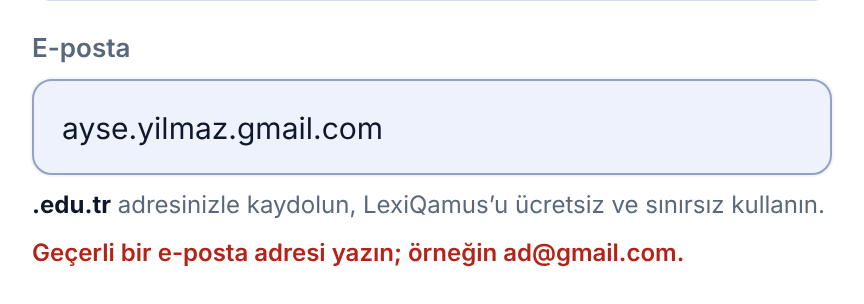
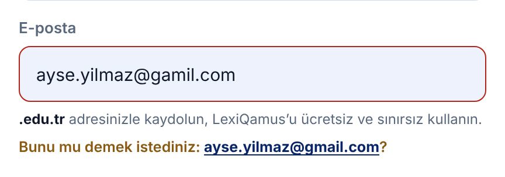
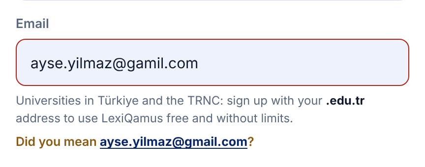
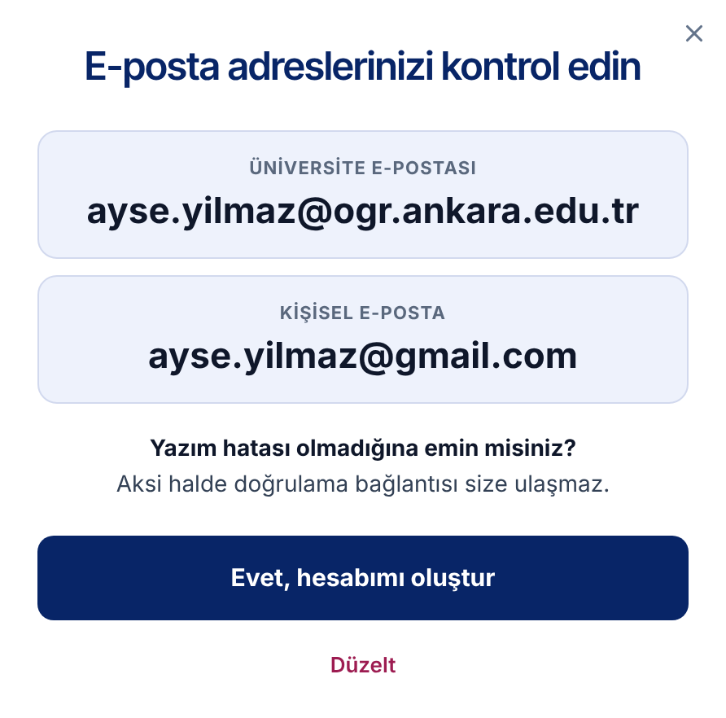
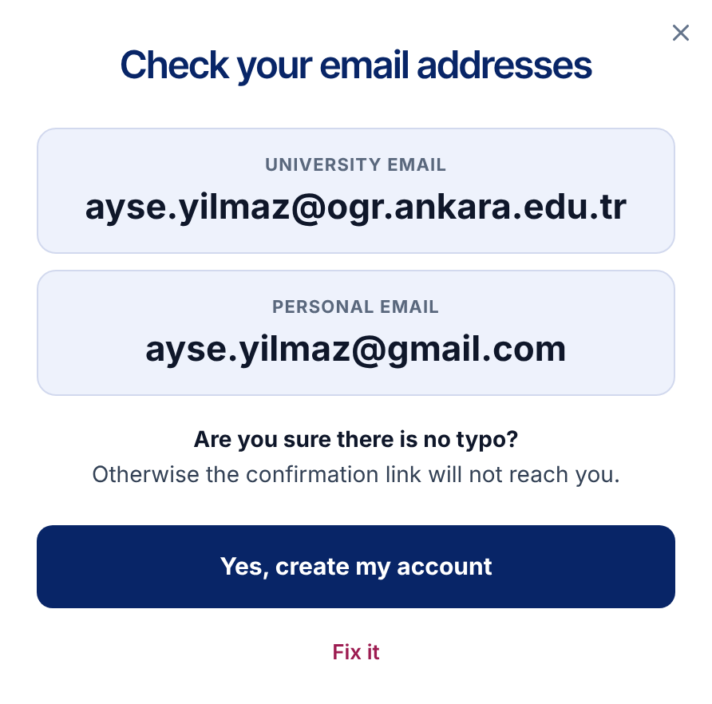
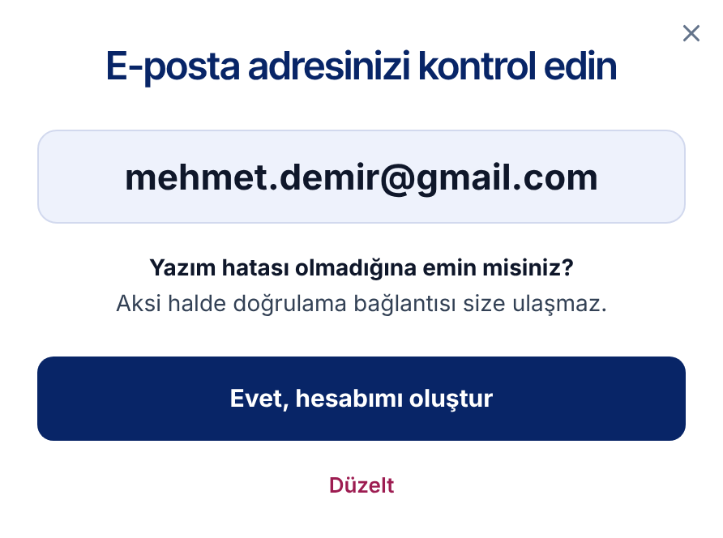
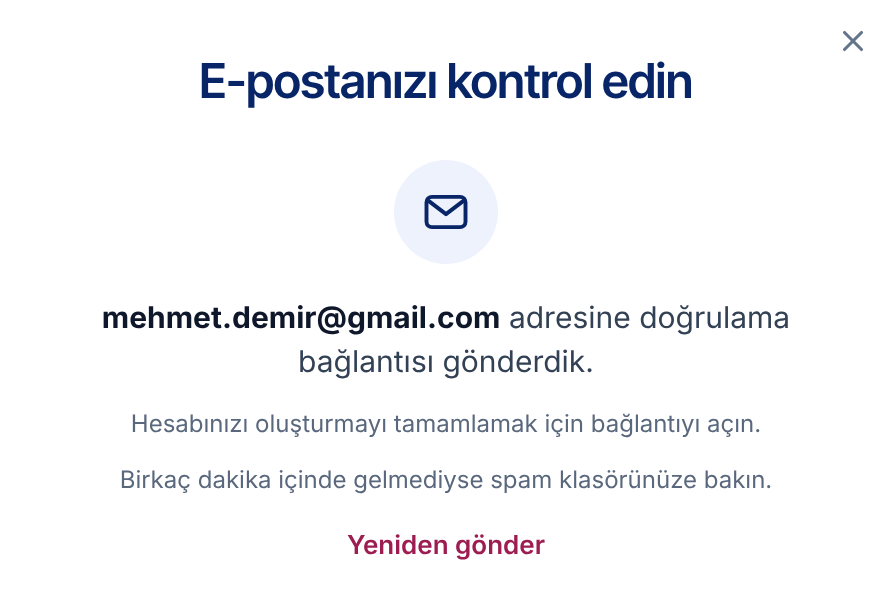

# LQ-CV-2 — Sign-up with a university address: two addresses, two links, one account

- **Area:** The sign-up window, and two new steps shown after it
- **Type:** Change to the form, two new steps, and new account rules on the server
- **Front end:** done in the new front end (`muhammethabib/lq-frontend`, commits `850b9c6`, `901fded`, `99858fd` and `6816be7`)
- **Server:** a second address on the account, a confirmation link to each address, address checks, and a review list for support (see *What the server needs to do*)

---

## Summary

Accounts made with a `.edu.tr` address get free, unlimited access. Today the
sign-up form never says so, and when the confirmation email does not reach a
university address — which happens: university mail systems block or delay
it — the person is stuck and drops out.

The new flow:

1. **The form says a university address makes it free**, and turns that line
   green as soon as one is typed.
2. **A university address also asks for a personal address.** Both are
   checked for typos before the form can go on.
3. **The addresses are shown large** before the account is made, with the
   question *Are you sure there is no typo?* — a mistyped address is one the
   link never reaches.
4. **A confirmation link goes to each address.** There is one account, and
   **either link opens it**, with full access.
5. **Support follows up** on accounts whose university address was never
   confirmed: writes to the person, asks for institution, programme and year,
   and blocks the account if the university address turns out to be made up.
6. **The newsletter box starts unticked.** Today it is ticked in advance.
   Under KVKK and the GDPR, consent to marketing mail has to be given by the
   user; a box that is already ticked does not count as consent.

## Decisions already taken

- **One account, two addresses.** The university address is the main one; the
  personal address is the second one.
- **A separate confirmation link to each address,** sent at the same time.
- **Clicking a link confirms that address.**
- **Either link opens the account, with full access.** There is no waiting
  period and no time limit. University mail is often blocked, and a real
  student or teacher must not be locked out because of it.
- **Typos are caught on the form.** An address that is not an email address,
  or that has a common typo (`gamil` for `gmail`), does not create an account.
- **Support checks unconfirmed university addresses afterwards** and blocks
  the account if the address is made up. Such cases are few.

## Today

The newsletter box is already ticked, nothing mentions `.edu.tr`, there is no
second address and no check before the account is made.


## New

### 1. The form

The line under *Email* is new; the newsletter box is unticked.


### 2. Address checks

**Not an email address** — refused, with an example:



**A likely typo** — the corrected address is offered back; one press puts it
in the field. The form does not go on until the address is fixed:





### 3. A university address is typed

The line turns green and the *Personal email* field opens below it. It is
required:


The personal email cannot be another university address:


### 4. After *Create account*: the addresses, large

**University sign-up** — both addresses, labelled:





**Personal-address sign-up** — the one address:



### 5. After *Yes, create my account*: check your inbox

**University sign-up** — a link went to each address; either one opens the
account:


**Personal-address sign-up:**



## How it behaves

1. When the form opens, the line under *Email* shows the offer. The
   *Personal email* field is not shown.
2. As the person types, the page checks the address after every key press.
   If the part after `@` ends in `edu.tr`:
   - the offer is swapped for a green tick and the confirmation;
   - the *Personal email* field appears and becomes required.

   If the address is changed so that it no longer ends in `edu.tr`, the
   offer comes back and the field goes away again.
3. **Each address is checked when the person leaves the field, and again on
   *Create account*:**
   - no `@`, or no proper domain → *Enter a valid email address, such as
     name@gmail.com.*
   - a likely typo → *Did you mean …?* with the corrected address as a button;
   - the personal email empty → *Please add a personal email as well.*
   - the personal email is also a university address → *Use an address
     outside your university, such as Gmail or Outlook.*

   While any of these is showing, *Create account* does not go on, and the
   cursor goes to that field.
4. **The typo check** catches:
   - a domain one or two letters away from a common provider: `gmail.com`,
     `hotmail.com`, `outlook.com`, `yahoo.com`, `icloud.com`, `yandex.com`,
     `live.com`, `hotmail.com.tr`, `outlook.com.tr`, `yandex.com.tr`
     (so `gamil.com`, `gmial.com`, `gmail.con`, `hotmial.com`, `outlok.com`);
   - a broken university ending: `edutr`, `edu.rt`, `.edu.t`, `.edu.trr`,
     `.eud.tr`, `.ude.tr` → `.edu.tr`.

   Real domains that sit close to a common provider are never "corrected":
   `mail.com`, `email.com`, `ymail.com`, `gmx.com`, `gmx.de`, `gmx.net`,
   `me.com`, `mac.com`, `aol.com`, `msn.com`, `proton.me`, `protonmail.com`,
   `yandex.ru`, `mail.ru`, `ttmail.com`.
5. **Create account** shows the addresses large, with *Are you sure there is
   no typo? Otherwise the confirmation link will not reach you.*
   - *Yes, create my account* creates the account and goes to the inbox step.
   - *Fix it* goes back to the form, with everything still filled in.
6. **The inbox step** names the address (or both addresses) the links went
   to, says that either one opens the account, and offers *Send it again*.
7. The newsletter box is unticked when the form opens.
8. Screen readers hear the changing lines (the hint, the errors and the
   suggestion are polite live regions).

The checks, as written in the front end:

```js
// a university address in Türkiye or the TRNC
/@([a-z0-9-]+\.)*edu\.tr$/i
// the shape of an email address
/^[^\s@]+@[^\s@.]+(\.[^\s@.]+)*\.[a-z]{2,}$/i
```

The *Personal email* field is asked only of university addresses: anyone
signing up with Gmail, Outlook and so on is already giving a personal
address.

## New text

Copy these exactly. Bold parts are marked with `<b>…</b>`. The Turkish text
addresses the reader as *siz*, as the rest of the site does.

**The form**

| Part | English | Turkish |
|------|----------|----------|
| Offer (before a university address is typed) | `Universities in Türkiye and the TRNC: sign up with your <b>.edu.tr</b> address to use LexiQamus free and without limits.` | `<b>.edu.tr</b> adresinizle kaydolun, LexiQamus’u ücretsiz ve sınırsız kullanın.` |
| Confirmation (after one is typed) | `University address: free, unlimited access.` | `Üniversite adresi: ücretsiz ve sınırsız erişim.` |
| Personal email, label | `Personal email` | `Kişisel e-posta` |
| Personal email, hint | `We will send a confirmation link here too; opening either one activates your account. Our support team can also reach you here.` | `Doğrulama bağlantısını bu adrese de göndereceğiz; hangisini açarsanız hesabınız açılır. Destek ekibimiz de size bu adresten ulaşabilir.` |
| Error, not an email address | `Enter a valid email address, such as name@gmail.com.` | `Geçerli bir e-posta adresi yazın; örneğin ad@gmail.com.` |
| Error, personal email empty | `Please add a personal email as well.` | `Kişisel e-posta adresinizi de yazın.` |
| Error, personal email is a university one | `Use an address outside your university, such as Gmail or Outlook.` | `Üniversite dışı bir adres yazın; örneğin Gmail ya da Outlook.` |
| Typo, before the address | `Did you mean` | `Bunu mu demek istediniz:` |
| Typo, after the address | `?` | `?` |

**Before the account is made**

| Part | English | Turkish |
|------|----------|----------|
| Title, one address | `Check your email address` | `E-posta adresinizi kontrol edin` |
| Title, two addresses | `Check your email addresses` | `E-posta adreslerinizi kontrol edin` |
| Label, university address | `University email` | `Üniversite e-postası` |
| Label, personal address | `Personal email` | `Kişisel e-posta` |
| Question | `Are you sure there is no typo?` | `Yazım hatası olmadığına emin misiniz?` |
| Why | `Otherwise the confirmation link will not reach you.` | `Aksi halde doğrulama bağlantısı size ulaşmaz.` |
| Main button | `Yes, create my account` | `Evet, hesabımı oluştur` |
| Second button | `Fix it` | `Düzelt` |

**The inbox step**

| Part | English | Turkish |
|------|----------|----------|
| Title | `Check your inbox` | `E-postanızı kontrol edin` |
| One address — before it | `We sent a confirmation link to` | *(empty)* |
| One address — after it | `.` | ` adresine doğrulama bağlantısı gönderdik.` *(starts with a space)* |
| Two addresses — before them | `We sent a confirmation link to` | *(empty)* |
| Two addresses — between them | `and to` | `ve` |
| Two addresses — after them | `.` | ` adreslerine doğrulama bağlantısı gönderdik.` *(starts with a space)* |
| Next line, one address | `Open it to finish creating your account.` | `Hesabınızı oluşturmayı tamamlamak için bağlantıyı açın.` |
| Next line, two addresses | `Open either one to finish creating your account.` | `Hangisini açarsanız hesabınız açılır.` |
| If it does not arrive | `Not there in a few minutes? Check your spam folder.` | `Birkaç dakika içinde gelmediyse spam klasörünüze bakın.` |
| Link | `Send it again` | `Yeniden gönder` |

English puts the addresses after the words and Turkish before them, so each
line has a slot on each side.

## What the server needs to do

**The account**

1. **One account, two addresses.** Store the personal address as the
   account's second email whenever one is given (only with a university
   address).
2. **Each address has its own confirmation state** — for example
   `university_email_confirmed_at` and `personal_email_confirmed_at`.
3. **The account has its own status:** *active*, *blocked*. It becomes
   active when either address is confirmed.
4. **Access:** an active account with a university address gets full access,
   whichever of the two links was clicked.
5. **No address may belong to two accounts** — neither the university nor
   the personal one, in either column. Otherwise the same person can open a
   second account.
6. **Sign-in and password reset work with either address.**

**The links**

7. **Send a separate confirmation link to each address,** at the same time.
8. **Clicking a link confirms that address** and opens the account if it is
   not open yet.
9. **One link does not cancel the other.** After the personal link is
   clicked, the university link stays valid, so the university address can
   still be confirmed later. Give the links a long life (for example 7 days).
10. **Send it again** sends a fresh link to each address that is not confirmed
    yet. Keep a short wait between sends (for example 60 seconds).
11. **Account settings offer *Send the confirmation link again*** for a
    university address that is still not confirmed.

**The checks**

12. **Repeat the form's checks on the server** (shape, personal address
    required with a university address, personal address not a university
    one). The front end checks them already; the server should not rely on
    it.
13. **Check that each domain can receive mail** (an MX record lookup). This
    also catches made-up university domains on its own. A made-up name on a
    real university domain can only be caught by the follow-up below.

**Support**

14. **A list in the admin of active accounts whose university address is not
    confirmed,** with both addresses, so support knows whom to write to.
15. **Support writes to the personal address,** asks for institution,
    programme and year, and confirms the person — or blocks the account if
    the university address turns out to be made up.
16. **Support can mark a university address as confirmed by hand,** and can
    block an account.

**Consent**

17. **Store newsletter consent only when the box was ticked.** If the server
    sets a default anywhere (a model default, a migration, a hidden field),
    it should default to *no*. Existing members are not affected.

## In the new front end

| What | Where |
|----|------------|
| Markup | `js/page_chrome.js` — `authTemplate`: `#signUpEmailHint`, `#signUpEmailError`, `#signUpPersonalField`, `#signUpConfirmPane`, `#signUpSentPane` |
| Behaviour | `js/controllers/page_chrome_controller.js` — `UNIVERSITY_ADDRESS`, `EMAIL_SHAPE`, `COMMON_MAIL_DOMAINS`, `OTHER_MAIL_DOMAINS`, `UNIVERSITY_SLIPS`, `correctedAddress()`, `wireSignUp()`, `confirmAddresses()`, `showSent()` |
| Look | `css/account-window.css` — `.auth-edu`, `.auth-error`, `.auth-suggest`, and the *before the account is made* and *after sign-up* sections |
| Turkish text | `js/translations.js` — `authEdu…`, `authPersonal…`, `authEmailFormat`, `authSuggest…`, `authUniversityEmail`, `authConfirm…`, `authSent…`, `authResend` |
| To see it | side menu → **Sign up** |

In the front end the steps after the form are shown as soon as it is sent,
and *Send it again* does nothing yet. The real sending, and anything the
server says back (an address already in use, a password that is too weak),
is for the integration.

## Done when

- [ ] The offer line shows under *Email* when the form opens.
- [ ] Typing a `.edu.tr` address turns it green and opens the required
      *Personal email* field; changing it back hides the field again.
- [ ] An address without `@` or a proper domain is refused; a common typo
      is offered back corrected and the form does not go on until it is
      fixed — on the page and on the server.
- [ ] An empty or university personal email is refused, on the page and on
      the server.
- [ ] *Create account* shows the addresses large; *Fix it* goes back with the
      form still filled in.
- [ ] A university sign-up sends a link to each address; either one opens
      the account with full access, and the other stays valid.
- [ ] No address can be used by two accounts.
- [ ] Support has a list of active accounts with an unconfirmed university
      address, can confirm one by hand, and can block an account.
- [ ] The newsletter box is unticked when the form opens, and the server
      records consent only when it is ticked.
- [ ] Turkish and English text match the tables above.
