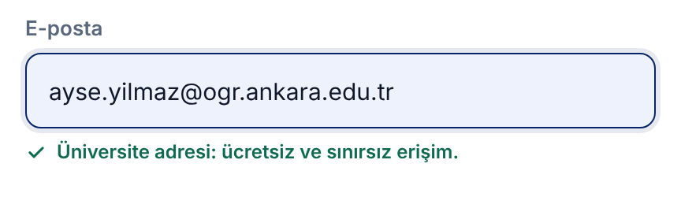
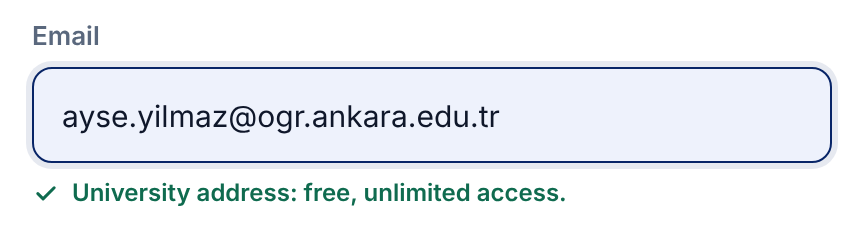

# LQ-CV-2 — The sign-up form says a university address makes it free

- **Area:** The sign-up window
- **Type:** Small change — one new line under the email field, and one tick box that starts unticked
- **Front end:** done in the new front end (`muhammethabib/lq-frontend`, commit `850b9c6`)
- **Server:** only the consent box needs a check (see *What the server needs to do*)

---

## Summary

The sign-up form today never says that a `.edu.tr` address gets free,
unlimited access — the very reason most people are signing up. Two changes:

1. **A line under the email field** offers it, and turns into a green
   confirmation as soon as the visitor types a university address.
2. **The newsletter box starts unticked.** Today it is ticked in advance.
   Under KVKK and the GDPR, consent to marketing mail has to be given by the
   user; a box that is already ticked does not count as consent.

## Today

The newsletter box is already ticked, and nothing mentions `.edu.tr`.


## New

**The whole form (English).** The line under *Email* is new; the newsletter
box is unticked.


**While typing a non-university address** — the offer stays:


**As soon as the address is a university one** — the line turns green:





## How it behaves

1. When the form opens, the line under *Email* shows the offer.
2. As the visitor types, the page checks the address after every key press.
3. If the part after `@` ends in `edu.tr` (for example `ogr.ankara.edu.tr`,
   `metu.edu.tr`), the offer is swapped for a green tick and the
   confirmation.
4. If the visitor changes the address so that it no longer ends in `edu.tr`,
   the offer comes back.
5. Screen readers hear the change (the line is a polite live region).
6. The newsletter box is unticked when the form opens.

The check, as written in the front end:

```js
/@([a-z0-9-]+\.)*edu\.tr$/i
```

## New text

Copy these exactly. Bold parts are marked with `<b>…</b>`.

| Part | English | Turkish |
|------|----------|----------|
| Offer (before a university address is typed) | `Universities in Türkiye and the TRNC: sign up with your <b>.edu.tr</b> address to use LexiQamus free and without limits.` | `<b>.edu.tr</b> adresinle kaydol, LexiQamus’u ücretsiz ve sınırsız kullan.` |
| Confirmation (after one is typed) | `University address: free, unlimited access.` | `Üniversite adresi: ücretsiz ve sınırsız erişim.` |

## What the server needs to do

1. **Store newsletter consent only when the box was ticked.** If the server
   sets a default anywhere (a model default, a migration, a hidden field),
   it should default to *no*.
2. **Existing members are not affected.** This only changes what a new
   sign-up starts with.
3. **The free access itself does not change.** The form only *says* what the
   server already does for `.edu.tr` addresses. If the server's own rule for
   which addresses count is different from the check above, tell us and we
   will make the front end match it.

## In the new front end

| What | Where |
|----|------------|
| Markup | `js/page_chrome.js` — the sign-up form in `authTemplate`, `#signUpEmailHint` |
| Behaviour | `js/controllers/page_chrome_controller.js` — `UNIVERSITY_ADDRESS` and the `input` listener in `openAuth()` |
| Look | `css/account-window.css` — `.auth-edu` |
| Turkish text | `js/translations.js` — `authEduHint`, `authEduOk` |
| To see it | side menu → **Sign up** |

## Done when

- [ ] The offer line shows under *Email* when the form opens.
- [ ] Typing a `.edu.tr` address turns it into the green confirmation;
      changing it back brings the offer back.
- [ ] The newsletter box is unticked when the form opens, and the server
      records consent only when it is ticked.
- [ ] Turkish and English text match the table above.
