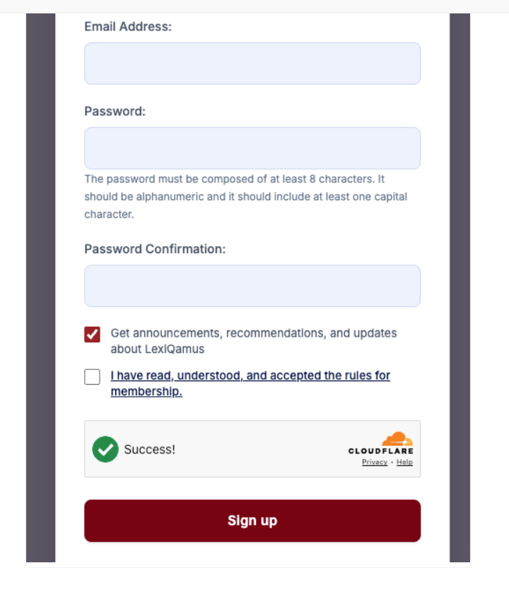
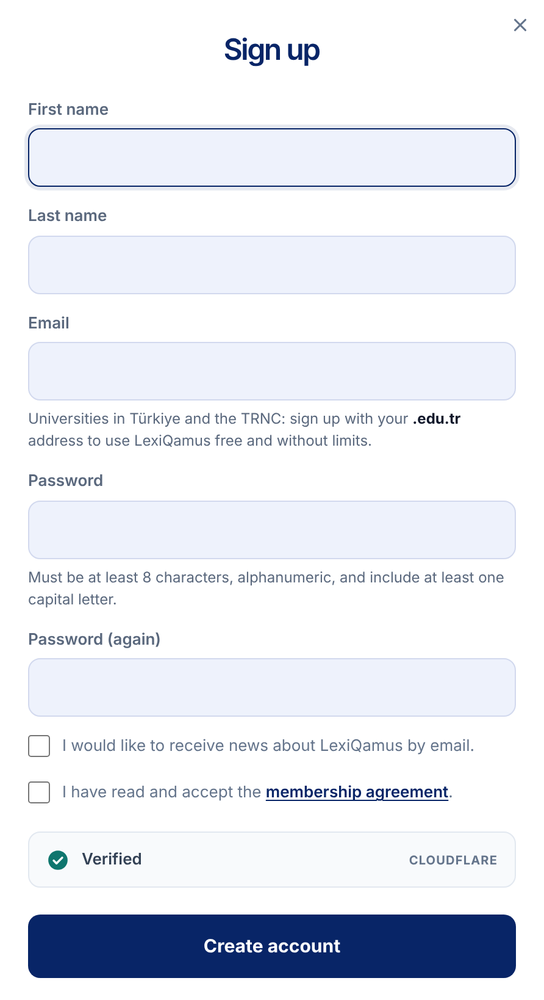
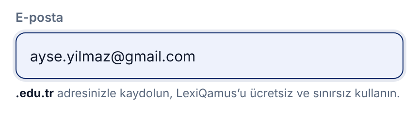
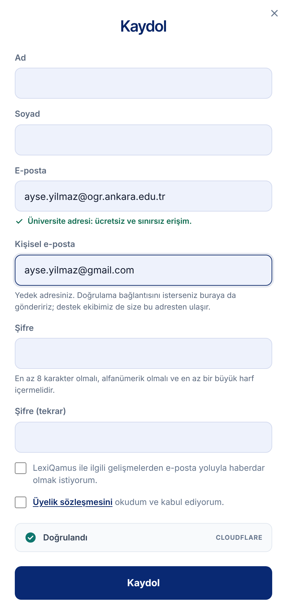
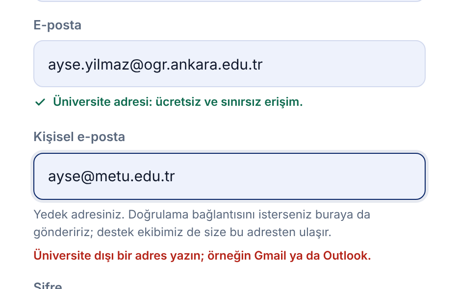
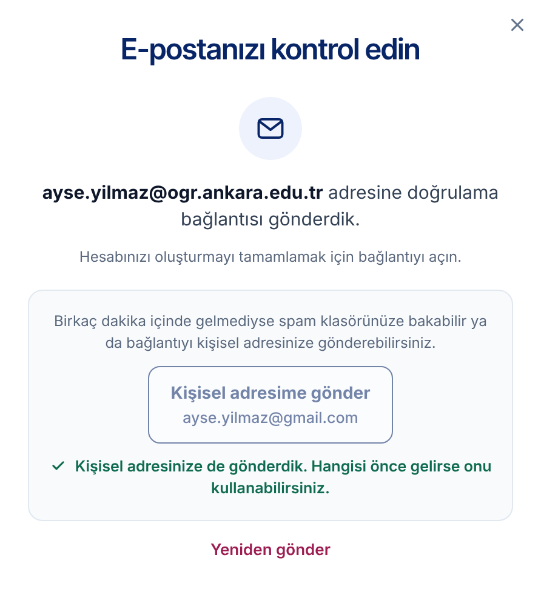
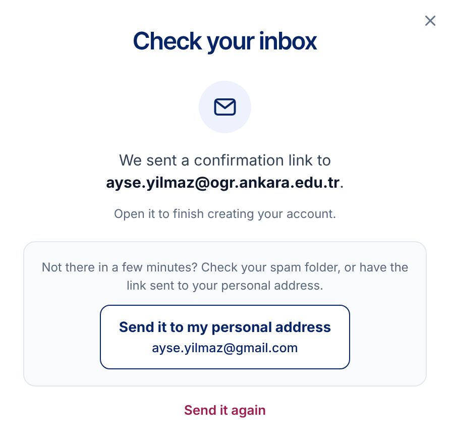
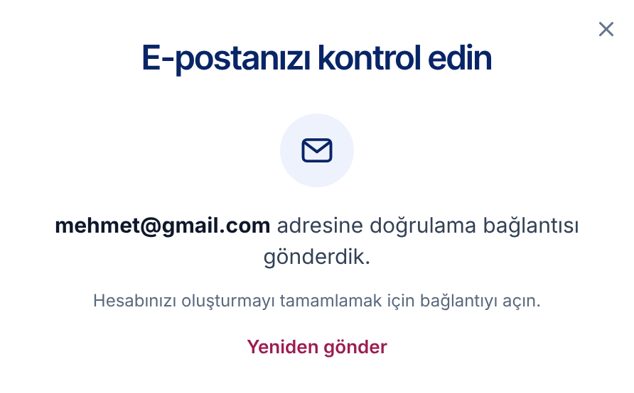

# LQ-CV-2 — Sign-up with a university address: the offer, a personal address, and the inbox step

- **Area:** The sign-up window, and a new step shown after it is sent
- **Type:** Change to the form, plus one new step
- **Front end:** done in the new front end (`muhammethabib/lq-frontend`, commits `850b9c6`, `901fded` and `99858fd`)
- **Server:** store a second address, send the confirmation to either address, and record newsletter consent correctly (see *What the server needs to do*)

---

## Summary

Accounts made with a `.edu.tr` address get free, unlimited access. The
sign-up form today never says so, and it gives no way out when the
confirmation email does not reach a university address — the person is
left stuck and drops out.

Four changes:

1. **A line under the email field** offers the free access, and turns into a
   green confirmation as soon as a university address is typed.
2. **A "Personal email" field** opens under it for a university address. It
   is required for them. It is a backup: the confirmation link can be sent
   there, and support can reach the person there.
3. **A "Check your inbox" step** replaces the form once it is sent. It says
   where the link went, and — for a university address — offers to send it
   to the personal address with one press.
4. **The newsletter box starts unticked.** Today it is ticked in advance.
   Under KVKK and the GDPR, consent to marketing mail has to be given by the
   user; a box that is already ticked does not count as consent.

## Today

The newsletter box is already ticked, nothing mentions `.edu.tr`, and there
is no second address.



## New

### 1. The form, before an address is typed

The line under *Email* is new; the newsletter box is unticked.



With a non-university address, the line stays as the offer:



### 2. A university address is typed

The line turns green, and the *Personal email* field opens below it.



If the personal email is left empty, or is another university address, the
form says so under the field and does not go on:



### 3. After *Create account*: check your inbox

**Signed up with a university address** — the link went to the university
address; the box offers the personal one. After the button is pressed, a
green line confirms it:





**Signed up with a personal address** — only where the link went, and
*Send it again*:



## How it behaves

1. When the form opens, the line under *Email* shows the offer. The
   *Personal email* field is not shown.
2. As the person types, the page checks the address after every key press.
   If the part after `@` ends in `edu.tr` (for example `ogr.ankara.edu.tr`,
   `metu.edu.tr`):
   - the offer is swapped for a green tick and the confirmation;
   - the *Personal email* field appears below and becomes required.
3. If the address is changed so that it no longer ends in `edu.tr`, the offer
   comes back and the *Personal email* field goes away again.
4. On *Create account*, for a university address:
   - an empty personal email shows *Please add a personal email as well.*;
   - a personal email that is also a university address shows *Use an
     address outside your university, such as Gmail or Outlook.*
   - in both cases the form stays, with the cursor in that field.
5. When the form is sent, the window's title becomes *Check your inbox* and
   it shows the address the link went to.
6. For a university address only, a box below says what to do if it does not
   arrive, with the button **Send it to my personal address** and the
   personal address under it. Pressing it sends the link there, greys the
   button out and shows the green confirmation line.
7. *Send it again* sends the link to the main address again.
8. The newsletter box is unticked when the form opens.
9. Screen readers hear the changing lines (the hint, the error and the
   confirmation are polite live regions).

The university-address check, as written in the front end:

```js
/@([a-z0-9-]+\.)*edu\.tr$/i
```

The *Personal email* field is asked only of university addresses: anyone
signing up with Gmail, Outlook and so on is already giving a personal
address, and a second field would only slow them down.

## New text

Copy these exactly. Bold parts are marked with `<b>…</b>`. The Turkish text
addresses the reader as *siz*, as the rest of the site does.

**The form**

| Part | English | Turkish |
|------|----------|----------|
| Offer (before a university address is typed) | `Universities in Türkiye and the TRNC: sign up with your <b>.edu.tr</b> address to use LexiQamus free and without limits.` | `<b>.edu.tr</b> adresinizle kaydolun, LexiQamus’u ücretsiz ve sınırsız kullanın.` |
| Confirmation (after one is typed) | `University address: free, unlimited access.` | `Üniversite adresi: ücretsiz ve sınırsız erişim.` |
| Personal email, label | `Personal email` | `Kişisel e-posta` |
| Personal email, hint | `A backup address. We can send your confirmation link here as well if you like, and our support team can reach you here.` | `Yedek adresiniz. Doğrulama bağlantısını isterseniz buraya da göndeririz; destek ekibimiz de size bu adresten ulaşır.` |
| Error, empty | `Please add a personal email as well.` | `Kişisel e-posta adresinizi de yazın.` |
| Error, a university address | `Use an address outside your university, such as Gmail or Outlook.` | `Üniversite dışı bir adres yazın; örneğin Gmail ya da Outlook.` |

**The inbox step**

| Part | English | Turkish |
|------|----------|----------|
| Title | `Check your inbox` | `E-postanızı kontrol edin` |
| Before the address | `We sent a confirmation link to` | *(empty)* |
| After the address | `.` | ` adresine doğrulama bağlantısı gönderdik.` *(starts with a space)* |
| Next line | `Open it to finish creating your account.` | `Hesabınızı oluşturmayı tamamlamak için bağlantıyı açın.` |
| If it does not arrive (university address only) | `Not there in a few minutes? Check your spam folder, or have the link sent to your personal address.` | `Birkaç dakika içinde gelmediyse spam klasörünüze bakabilir ya da bağlantıyı kişisel adresinize gönderebilirsiniz.` |
| Button (university address only) | `Send it to my personal address` | `Kişisel adresime gönder` |
| After the button is pressed | `Sent to your personal address too. Use whichever arrives first.` | `Kişisel adresinize de gönderdik. Hangisi önce gelirse onu kullanabilirsiniz.` |
| Link | `Send it again` | `Yeniden gönder` |

English puts the address after the words and Turkish before them, so the line
has a slot on each side.

## What the server needs to do

1. **Store the personal address** with the account, as a second email,
   whenever one is given. It is given only with a university address.
2. **Check it on the server too:** required when the main address ends in
   `edu.tr`, and not itself an `edu.tr` address. The front end checks this
   already; the server should not rely on it.
3. **Send the confirmation link to the university address first.**
4. **"Send it to my personal address"** sends the same link (or a fresh one)
   to the personal address. Either link confirms the account. Confirming
   through the personal address must still give the account its university
   access — the access comes from the university address, not from which
   inbox the link was opened in.
5. **"Send it again"** sends the link to the main address again. A short
   wait between sends (for example 60 seconds) keeps it from being pressed
   over and over.
6. **Show the personal address to the support team** in the admin, next to
   the main address.
7. **Store newsletter consent only when the box was ticked.** If the server
   sets a default anywhere (a model default, a migration, a hidden field),
   it should default to *no*. Existing members are not affected.
8. **The free access rule does not change.** If the server's own rule for
   which addresses count is different from the check above, tell us and we
   will make the front end match it.

## In the new front end

| What | Where |
|----|------------|
| Markup | `js/page_chrome.js` — `authTemplate`: `#signUpEmailHint`, `#signUpPersonalField`, and the new `#signUpSentPane` |
| Behaviour | `js/controllers/page_chrome_controller.js` — `UNIVERSITY_ADDRESS`, `wireSignUp()` and `showSent()` |
| Look | `css/account-window.css` — `.auth-edu`, `.auth-error` and the *after sign-up* section |
| Turkish text | `js/translations.js` — `authEdu…`, `authPersonal…`, `authSent…`, `authSendPersonal`, `authResend` |
| To see it | side menu → **Sign up** |

In the front end the inbox step is shown as soon as the form is sent, and its
two buttons only change what is on screen. The real sending, and anything
the server says back (an address already in use, a password that is too
weak), is for the integration.

## Done when

- [ ] The offer line shows under *Email* when the form opens.
- [ ] Typing a `.edu.tr` address turns it green and opens the required
      *Personal email* field; changing it back hides the field again.
- [ ] An empty or university personal email is refused, on the page and on
      the server.
- [ ] After sign-up the inbox step names the address the link went to.
- [ ] For a university address, *Send it to my personal address* sends the
      link there, and confirming from either inbox gives university access.
- [ ] Support can see the personal address.
- [ ] The newsletter box is unticked when the form opens, and the server
      records consent only when it is ticked.
- [ ] Turkish and English text match the tables above.
