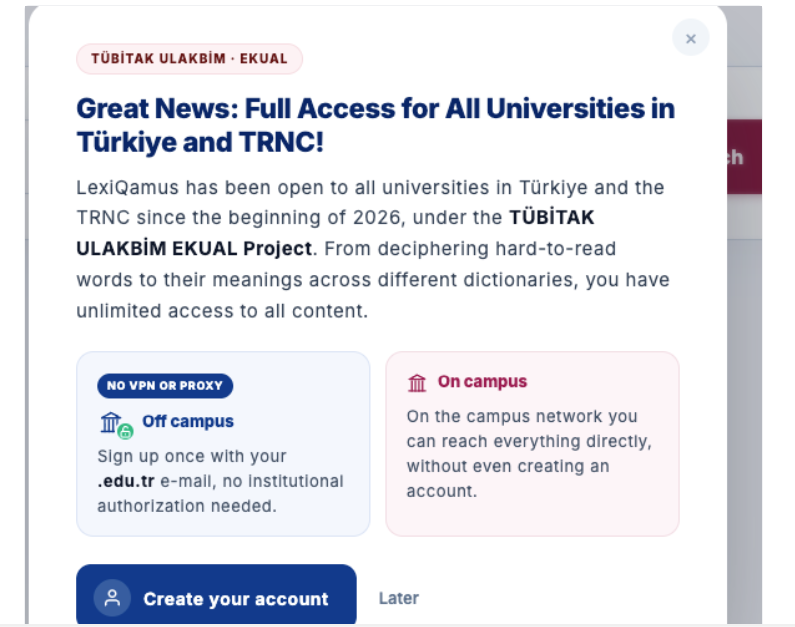
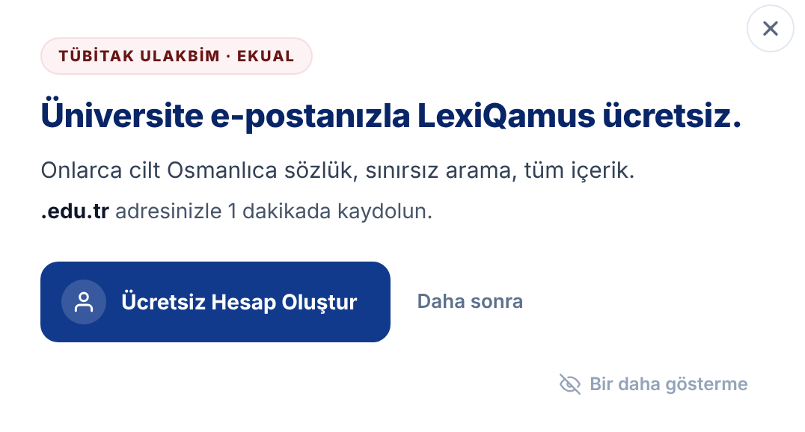
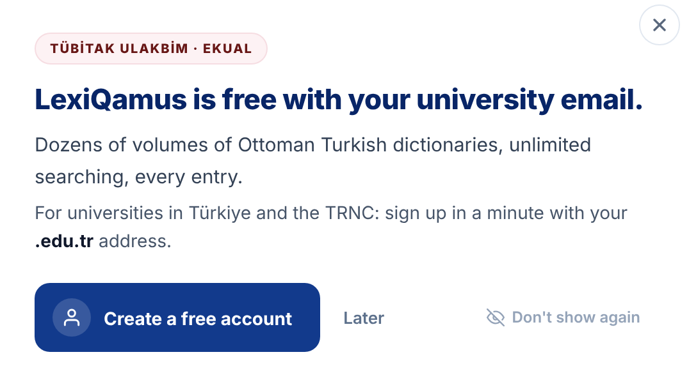

# LQ-CV-3 — The EKUAL announcement is cut to the offer

- **Area:** The announcement window a first-time visitor sees (TÜBİTAK ULAKBİM EKUAL)
- **Type:** Wording and layout change
- **Front end:** done in the new front end (`muhammethabib/lq-frontend`, commits `850b9c6`, `56a4234` and `4f4807e`)
- **Server:** nothing

---

## Summary

The announcement today says a lot at once: ULAKBİM, EKUAL, the TRNC,
VPN/proxy, on campus and off campus. The one thing a visitor needs to take
from it — *it is free with my university email* — gets lost. A visitor
should get the answer to "what does this mean for me?" in two seconds.

The new window says only that, with one button. The two campus cards are
gone. The **TÜBİTAK ULAKBİM · EKUAL** badge stays at the top, as the credit.

## Today

## New

**Turkish**

**English**

## What changes

- **Kept:** the badge, the close button, *Later*, *Don't show again*, and
  what the main button does (it opens the sign-up window).
- **New wording:** title, one line about what is included, one line about
  how to sign up, and the button text.
- **Removed:** the long paragraph and the two cards (*Off campus* / *On
  campus*), with their pill (*No VPN or proxy*).

Campus access is still true, it is just no longer in this window. A short
note about it belongs in the FAQ or the user guide.

## New text

Copy these exactly. Bold parts are marked with `<b>…</b>`.

| Part | English | Turkish |
|------|----------|----------|
| Badge *(unchanged)* | `TÜBİTAK ULAKBİM · EKUAL` | `TÜBİTAK ULAKBİM · EKUAL` |
| Title | `LexiQamus is free with your university email.` | `Üniversite e-postanla LexiQamus ücretsiz.` |
| What is included | `Dozens of volumes of Ottoman Turkish dictionaries, unlimited searching, every entry.` | `Onlarca cilt Osmanlıca sözlük, sınırsız arama, tüm içerik.` |
| How to sign up | `For universities in Türkiye and the TRNC: sign up in a minute with your <b>.edu.tr</b> address.` | `<b>.edu.tr</b> adresinle 1 dakikada kaydol.` |
| Button | `Create a free account` | `Ücretsiz Hesap Oluştur` |
| Second button *(unchanged)* | `Later` | `Daha sonra` |
| Corner link *(unchanged)* | `Don't show again` | `Bir daha gösterme` |

The English line says who the offer is for (*For universities in Türkiye and
the TRNC*), because most English readers are outside Türkiye. The Turkish
line does not need it.

*"Dozens of volumes"* is used instead of a number so it stays true as
volumes are added and never needs updating.

## Related: the bar at the top of the live site

The live site also has a bar across the top of the page with the same offer
in three lines (title, two sentences about campus and Premium). Two things to
check there:

- **A visitor should not get both at once.** If a first-time visitor sees
  the bar *and* this window, they are told the same thing twice. Show one or
  the other — for example the bar only after this window has been closed.
- **The bar's wording can follow this window:** one line, such as
  *Üniversite e-postanla LexiQamus ücretsiz. Hemen kaydol →* /
  *LexiQamus is free with your university email. Sign up →*

## In the new front end

| What | Where |
|----|------------|
| Markup | `pages/home.html` — `announcementTemplate` |
| Look | `css/announcement.css` — new `.announcement-how`; the card styles are removed |
| Turkish text | `js/translations.js` — `ekualTitle`, `ekualBody`, `ekualHow`, `ekualCta` (the `ekualPill`, `ekualOff…` and `ekualOn…` keys are removed) |
| To see it | the view switcher on the main page → **Home – New Visitor** |

## Done when

- [ ] The window shows the badge, the new title and the two new lines, and
      no campus cards.
- [ ] *Create a free account* opens the sign-up window; *Later* and *Don't
      show again* work as before.
- [ ] Turkish and English text match the table above.
- [ ] A first-time visitor does not get this window and the top bar at the
      same time.
